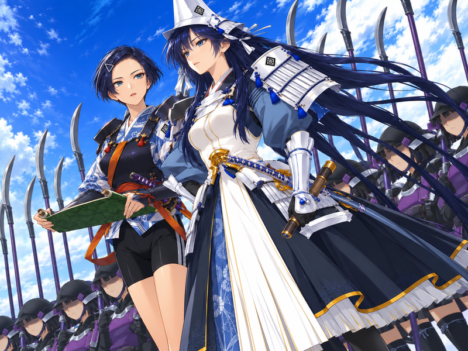
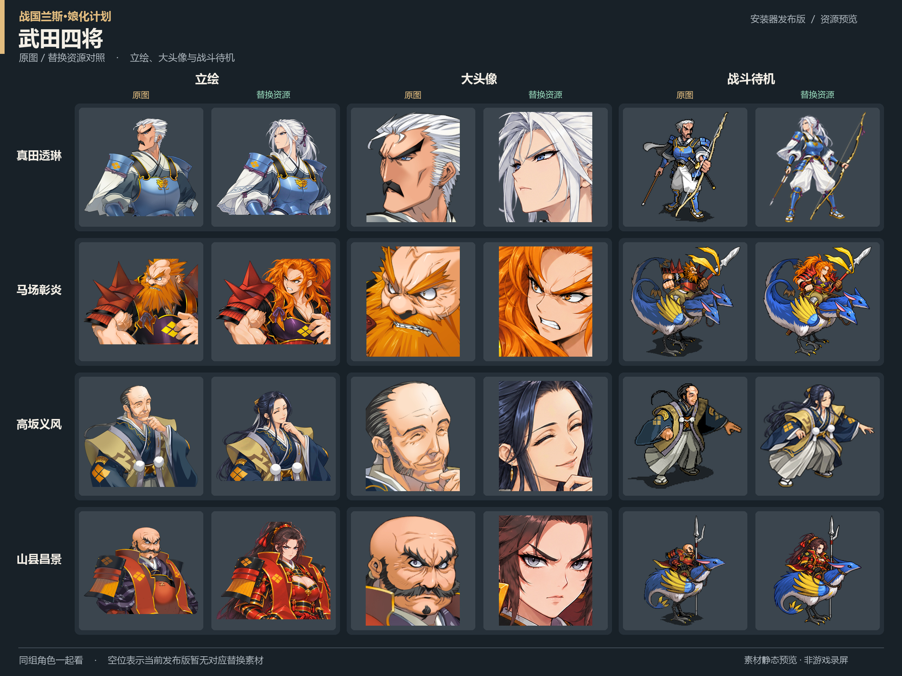
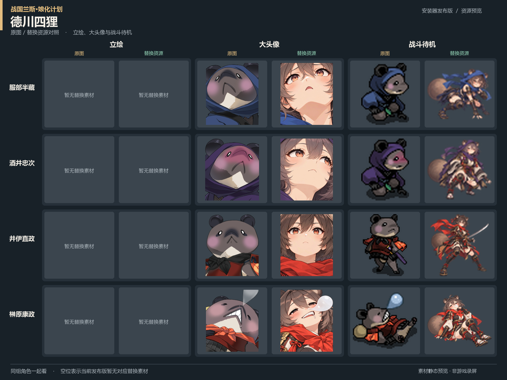
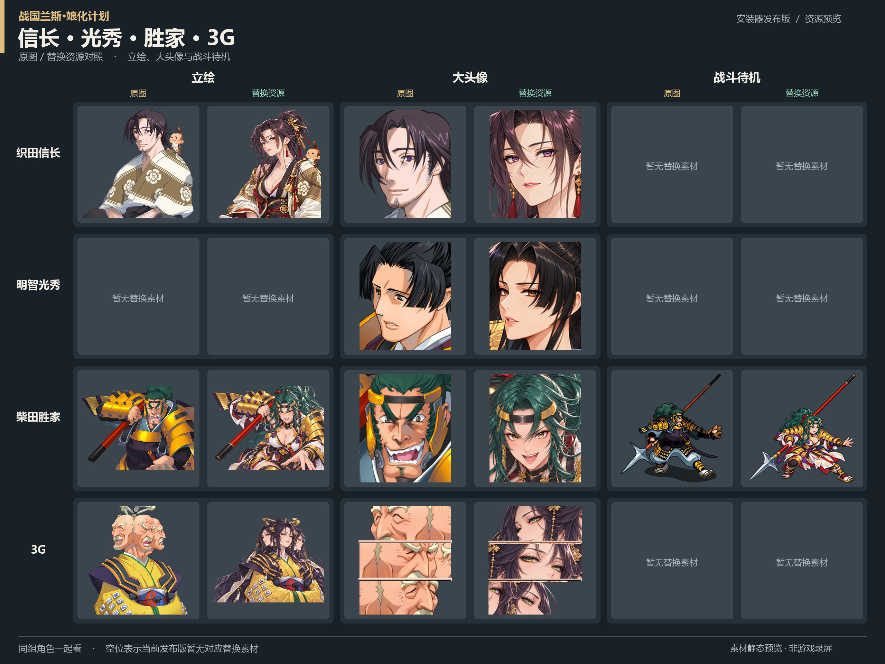

# 战国兰斯 · 娘化计划

**CY 发布｜GPT 辅助制作的武将形象替换 MOD，附本地网页一键安装器。**

项目地址：<https://github.com/cyghalt/SengokuRance-Mod-MoeProject>

## 为什么做这个项目

我玩《战国兰斯》时比较喜欢只用女武将，但有几位男武将的造型实在不合我的审美，或者过于猎奇、影响观瞻，所以用了 GPT 帮忙进行娘化。这是一个出于个人喜好的同人资源替换项目。

部分武将在制作时画风还没有统一。计划先处理完全部武将，再进行风格统一重绘；当前素材并不代表最终效果。

## 目前进度与计划

已娘化与已重绘角色名单见 [更新进度](更新进度.md)。

目前主要处理了游戏初期织田家及周边几家势力，并做了部分其他势力角色，尚未覆盖全势力。当前安装名单登记 **53 个角色 ID、500 个资源位置**（3G 合并计数后为 50 人／组）；同一角色可能包含头像、表情、战斗动作、立绘以及 GA／GM 两个包中的对应资源，资源位置数不等于图片数。

2026-10-14 更新：同步除兰斯、希露以外的全部已替换素材与 CG，补齐香姬、山本五十六、明石风丸、言里等资源及最新小头像，包含已登记的 6 个 CG 来源位置。

2026-10-12 更新：同步上杉谦信、直江爱、玉签风华的新版立绘与头像，加入大道寺小松（北条家）的立绘和大小头像、玉签风华小头像，以及上杉谦信出征 CG。具体差分与可选资源见安装器名单。

后续目标是全势力的人类、兽类、妖怪、反派等角色全员娘化。普通剧情 CG 也会陆续替换，例如下方的上杉谦信出征图。**NSFW 内容基本不做，不反对二次开发和资源替换。**

这张上杉谦信出征 CG 已加入当前安装名单；其他 CG 会陆续更新，以安装器名单为准。

## 效果展示

以下演示对比图中的原版部分仅用于说明替换效果。仓库不提供独立的游戏原版图片、剧本或完整游戏资源包。

更多对照图见 [宣传图目录](宣传图/README.md)。

## 网页一键安装器

安装器在自己的电脑上运行，通过浏览器操作，支持按角色或势力选择，也可以一键替换当前名单的全部资源。势力默认折叠；每位角色展示头像对照，以及已有替换的战斗形象对照。无需连接 GPT 或其他 AI 服务即可使用安装器。

**目前只测试了 Windows 下的 Steam 正版。** 其他版本可以借助 AI 和资源工具自行适配，自己动手丰衣足食；但不同版本的归档、编号和尺寸可能不同，不能保证直接通用。

### 推荐：下载打包好的 Windows 安装器

前往 [Releases 下载页](https://github.com/cyghalt/SengokuRance-Mod-MoeProject/releases/latest)，下载文件名带 `Installer` 和 `win64.zip` 的安装包（不要选 Source code）。完整解压到普通可写文件夹，双击 **SengokuRanceInstaller.exe** 或 **启动安装器.bat**。浏览器打开后，选择自己的游戏目录，检测状态，再选择角色安装。

打包版自带 Python、Pillow 和 alice-tools，无需另外安装依赖，也不需要 AI 服务。安装器窗口需保持打开；使用结束后关闭窗口即可。安装前退出游戏，保留安装器文件夹内的备份，以便恢复。当前提供 Windows 64 位版本，仍以 Windows Steam 版游戏为已测试范围。

### 源码版首次准备

1. 在本页 **Code → Download ZIP** 下载并完整解压，或使用 Git 克隆仓库。
2. 安装 Python 3.10 或更新版本，在项目目录运行 `python -m pip install -r requirements.txt`。文件夹选择窗口还需要 tkinter（Windows 官方 Python 通常自带）。
3. 从 [alice-tools 官方 Releases](https://github.com/nunuhara/alice-tools/releases) 下载 Windows 版本，将 `alice.exe` 及其依赖文件放到本项目的 `tools/` 目录，详见 [工具准备说明](tools/README.md)。源码仓库不包含第三方工具二进制；Releases 打包版已自带。

### 安装与恢复

1. 退出游戏，双击 **启动安装器.bat** 打开本地网页。也可运行 `python web_server.py`。
2. 选择自己的游戏目录，点击“检测状态”。当前名单要求目录内有 `rance7GA.ald` 和 `rance7GM.ald`。
3. 按需展开势力、勾选武将，点击“替换选中角色”；或使用“一键替换全部”。
4. 安装器会备份、编码、校验并替换资源，失败时回滚。安装完成后启动游戏确认实际显示效果；需要撤销时使用“从备份恢复”。

本地原图对照及剧本搜索需先到“资源解压与浏览”中点击“解压游戏资源与剧本”（还需 `rance7.ain`）。原版内容只从你自己的游戏中提取，保存在本机 `build/`，不会进入本仓库或导出的势力包。若提取时游戏已经安装其他替换，对照显示的是当时的本机资源。

## 自定义与自行替换

可以只安装自己喜欢的角色，按势力导出独立资源包，也可以修改势力归属、制作自己的替换资源。网页提供资源提取、图片浏览、剧本搜索和绑定名单导出；详细步骤见 [资源提取与替换说明](docs/资源提取与替换说明.md) 和 [角色资源绑定表](docs/README.md)。

新增人物或适配其他版本时，需要重新确认人物、资源编号、归档位置和图片尺寸。不要直接覆盖 `data/after/` 的图片：安装器会核对已登记的 SHA-256；制作自己的资源请按文档在独立工作区编辑并构建。

图片替换不等于改写人物设定、名字或剧情，也不会自动修改剧本文字。与其他图片 MOD 修改同一资源时可能冲突；恢复整包备份也会撤销备份之后对同一包的其他修改。

## 转载、整合与署名

资源可以转载、发布到网盘、修改后再发布，也欢迎成熟 MOD 收编、整合。不用单独来问我；转载或整合时，在项目 README、发布说明或致谢中保留 **“CY”或“CY 发布”**，并附上本项目地址即可。不要求游戏内水印、弹窗或额外署名界面，不影响正常使用模组。

我懒得维护网盘，只保留 Git 仓库作为发布和更新地址。别人提供的镜像、整合包可能不是最新版本。

代码和文档沿用 [MIT License](LICENSE)。替换素材的授权范围与署名方式见 [素材说明](ASSET_LICENSE.md)；原游戏及第三方内容的权利仍归各自权利人，这里的转载许可只涉及 CY 有权授权的贡献，不代表获得原游戏的授权。第三方组件见 [THIRD_PARTY_NOTICES.md](THIRD_PARTY_NOTICES.md)。

## 反馈

可在仓库 Issues 中反馈错绑、错位、动作异常或安装报错。请说明游戏版本、角色名、资源编号，并附截图或日志；日志发出前可以删去自己的本机路径。安装备份、提取出的游戏资源和完整游戏包请保留在本机。
